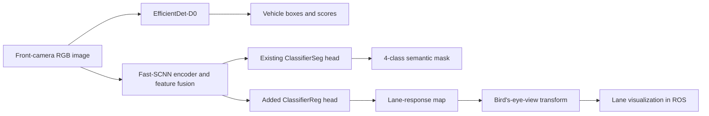

# Deep Learning for Autonomous Driving Perception

Perception work completed as part of the FreiCAR DiveDeep project. The focus was on detecting vehicles, understanding road-scene pixels, and estimating lane structure from front-camera images.

## At A Glance

| Task | Model | Output | Reported result |
| --- | --- | --- | --- |
| Object detection | EfficientDet-D0 | Vehicle bounding boxes and confidence scores | Trained checkpoint available; no verified numeric mAP report found |
| Semantic segmentation | Fast-SCNN | Four pixel classes | Validation mean IoU: **81.86%** |
| Segmentation + lane regression | Shared Fast-SCNN with segmentation and regression heads | Four pixel classes plus a lane-response map | Validation segmentation mean IoU: **84.02%**; lane-regression error not reported |

## System Overview

## Object Detection

The object detector uses **EfficientDet-D0** for single-class detection (`freicar`). It was trained with synthetic FreiCAR imagery and a held-out validation split. Anchor scales and aspect ratios were adapted to the dataset.

### Data And Training

The detection loader reads RGB frames and their bounding-box annotations from the same synthetic scene sequence. A predefined list of evaluation filenames separates validation examples from training examples. The images receive 12 pixels of zero padding at the top and bottom so their dimensions fit the detector's input constraints; the vertical coordinate of each box is shifted by the same amount to keep image pixels and labels aligned.

The detector predicts a class score and box adjustment for each anchor. Its anchor scales and aspect ratios were selected for the FreiCAR objects rather than left at generic defaults. Training combines focal classification loss, which emphasizes hard examples, with box-regression loss. The documented run command specifies AdamW, batch size 8, and learning rate `1e-5`. At inference, confidence filtering and non-maximum suppression reduce overlapping candidate boxes. The evaluation script sweeps confidence thresholds to form a precision-recall curve and uses an IoU matching threshold of `0.2`.

**Result:** A trained EfficientDet-D0 checkpoint is present in the project artifacts, but the available workspace does not contain a saved evaluation report or verified mAP value. I have therefore not claimed a numeric detection score. The project's custom evaluation settings should also be stated alongside any future score; they are not directly comparable to standard COCO mAP results.

## Semantic Segmentation

The segmentation model is **Fast-SCNN**, selected for its lightweight design for camera-based scene understanding. It predicts four pixel classes: **background, road, junction, and car**. The experiment report records a 50-epoch SGD run, with the best validation behavior around epoch 30.

### Data And Model Design

Each training sample pairs a camera image with a pixel-wise class mask; the same frame naming scheme is used to locate its label. Images are converted to floating-point RGB values, while masks remain integer class IDs so resizing can use nearest-neighbor interpolation without inventing class labels. The loader applies the same 12-pixel top-and-bottom padding to the image and its masks.

Fast-SCNN first reduces spatial resolution with efficient convolution blocks, then builds wider-context features with inverted-residual blocks and pyramid pooling. A feature-fusion stage combines those contextual features with a higher-resolution representation before the segmentation classifier predicts class logits. The logits are upsampled to the input image size for pixel-wise comparison with the ground-truth mask. Cross-entropy loss trains the classifier; mean IoU is tracked per class to make errors on smaller or less frequent scene regions visible.

### Segmentation-Only Results

Per-class intersection over union (IoU) from the experiment report:

| Class | Training IoU | Validation IoU |
| --- | ---: | ---: |
| Background | 99.09% | 97.47% |
| Road | 97.26% | 93.13% |
| Junction | 96.29% | 78.80% |
| Car | 88.48% | 58.02% |
| **Mean IoU** | **95.28%** | **81.86%** |

The largest validation gap was for the car class, while background and road segmentation were more consistent between training and validation.

## Lane Regression

For lane estimation, the existing Fast-SCNN segmentation model was extended with an additional **`ClassifierReg` lane-regression head**. In the forward pass, the fused Fast-SCNN features feed both the original `ClassifierSeg` head and the added regression head; the regression head does not take the segmentation logits as its input. This preserves the original segmentation output while adding a separate lane-response prediction. The experiment report describes a joint 50-epoch Adam run, with the selected model at epoch 38. Training combined cross-entropy segmentation loss with an L1 lane-regression loss; the report records scaling the regression loss by `1/16`.

The regression head predicts a dense, single-channel lane-response map. Because both heads use the same image encoder and fused features, they share visual context while retaining task-specific output layers and losses. During inference, the camera image is resized to `640 x 360`, normalized, and padded before a forward pass. The lane response is unpadded, normalized, and thresholded; a calibrated perspective homography then warps it into a bird's-eye-view image. This lane map is a separate output from the four-class semantic mask.

In the ROS workflow, the node consumes the vehicle's front-camera stream and publishes the generated lane visualization for downstream viewing. This makes the lane output inspectable in the simulator without requiring a separate hand-crafted lane detector.

### Joint-Model Segmentation Results

These are segmentation IoU scores from the joint run, not lane-regression accuracy:

| Class | Training IoU | Validation IoU |
| --- | ---: | ---: |
| Background | 98.95% | 97.82% |
| Road | 96.74% | 94.59% |
| Junction | 94.02% | 75.07% |
| Car | 86.75% | 68.59% |
| **Mean IoU** | **94.11%** | **84.02%** |

The report does not provide a numeric lane-regression error, so lane-regression performance is described qualitatively rather than assigned a score. The joint model's segmentation results are reported separately from the segmentation-only run and should not be read as a controlled comparison.

## Training And Evaluation Notes

- Dataset splits were based on synthetic FreiCAR camera imagery and a predefined evaluation split.
- Segmentation quality was measured with per-class IoU and mean IoU. Classes absent from an image were excluded from that image's IoU average.
- The experiment settings above are transcribed from the project report. The current segmentation script, for example, hardcodes 20 epochs and Adam with a `5e-3` learning rate; its lane-loss multiplier is `5`, rather than the report's `1/16`. The report also describes SGD for the segmentation-only run. These differences mean the published scores document historical runs and are not guaranteed to reproduce from the current script snapshot.
- The detection data loader contains optional brightness and horizontal-flip augmentation, but the current training setup does not enable its augmentation flag. It is therefore not claimed as part of the reported training results.
- Detection mAP and lane-regression error remain unreported because no verified numeric result for either metric was available in the project artifacts reviewed for this summary.

## Source And Data Availability

This document is a high-level project summary. Proprietary implementation code, model weights, and any restricted data are intentionally not included in this public-facing overview.